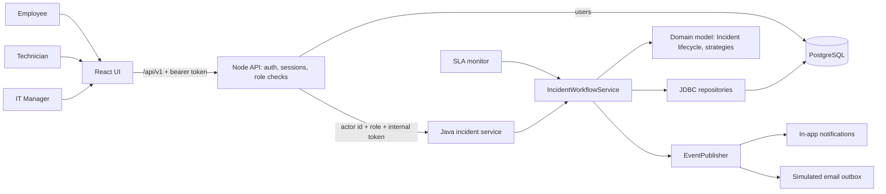
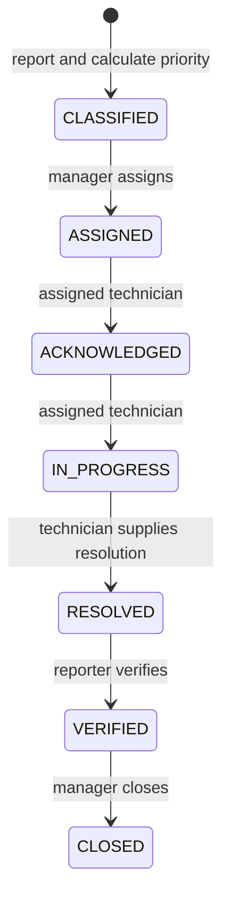

# Architecture and frontend handoff

## Scope and assumptions

An internal employee/support portal for ticketing IT incidents, not a passenger ticket-booking clone. Manager represents the Administrator / IT Manager course role. IRCTC incident examples and P1–P4 priorities are scenario inputs; SLA targets are illustrative course values, not official IRCTC policy. Course brief requirements describe the eventual delivery and do not imply the starter implements them all.

## Component view

## Navigation and ownership

| Route | Audience | Purpose |
| --- | --- | --- |
| `/` | All | Role overview and recent incidents |
| `/incidents` | All | Own reports, assigned work, or manager queue |
| `/incidents/new` | Employee | Create incident and preview priority |
| `/incidents/:id` | Scoped by role | Details, deadlines, resolution and history |
| `/management` | Manager | Workload summary and future configuration scope |

Frontend owner: components, page layouts, responsive behavior, form validation, API adapter, loading/error/empty states, accessibility and integration. Backend owner: authentication, authorization on every request, authoritative rules, data transactions, scheduling, notifications and database. Domain/OOP owner: state model, priority policy, strategy contracts and UML. Agree on API contracts before parallel implementation.

## Domain behavior

Creation classifies the incident immediately. Default priority uses impact × urgency × criticality with inputs 1–3: score >=18 is P1, >=8 is P2, >=3 is P3, otherwise P4. This is a proposed, explainable policy and can be refined for Tatkal, security and affected-user context. There is no AI/ML claim. Business impact, urgency and criticality currently need explicit human input.

SLA response/resolution targets in minutes: P1 5/30, P2 15/120, P3 60/480, P4 240/1440. Deadlines start at creation. A late acknowledgement or late resolution remains a recorded violation even after completion. UI refreshes deadline indicators every minute and on actions; there is no background escalation yet.

The demo offers skill-based (first available category match) and load-based (fewest active incidents) assignment implementations. Skill-based is wired as default; changing strategies is currently a code-level composition choice. Load-based is not skill-aware. A future manager UI should configure the choice and surface no-candidate outcomes.

## OOP design

Current code demonstrates Strategy (`AssignmentStrategy`, `SkillBasedAssignment`, `LoadBasedAssignment`), abstraction (`IncidentApi`) and composition (inject an assignment strategy into `MockIncidentApi`). UI uses domain functions and typed DTOs. Do not present this starter as a complete implementation of all OOP requirements.

Planned server: an encapsulated `Incident` aggregate validates state changes; `IncidentService` composes `PriorityPolicy`, `AssignmentStrategy`, `IncidentRepository` and `EventPublisher`. Repository is the second planned design pattern; Observer subscribers handle audit and two notification adapters. A `User` base abstraction with Employee/Technician/Manager specializations is appropriate only if distinct behavior justifies inheritance; do not add empty subclasses merely for a rubric.

Proposed database entities: User (role, password hash), TechnicianProfile (availability, skills), Service (criticality), Category, Incident (reporter/service/category/assignee/SLA-policy FKs, factors and timestamps), SlaPolicy, AuditEvent, Notification. Incident has many audit events and notifications. Persist incident changes and audit events atomically; server enforces actor identity from its session.

## Technology rationale

React supports reusable role-specific components; TypeScript gives the frontend/backend an explicit shared contract; Vite provides a small local dev/build setup. A modular monolith REST backend is adequate for this team and avoids distributed transactions. PostgreSQL is proposed for relational integrity and reporting. Java/Spring Boot remains a reasonable backend alternative if the team wants stronger class-based domain conventions. TypeScript requires deliberate runtime validation because types disappear at runtime.

Before real use: server sessions or reviewed token authentication, hashed passwords, request validation, role and ownership checks, protected audit records, database migrations, rate limits, secure deployment, pagination and automated integration tests. Frontend role visibility and local audit entries provide no security guarantee.
