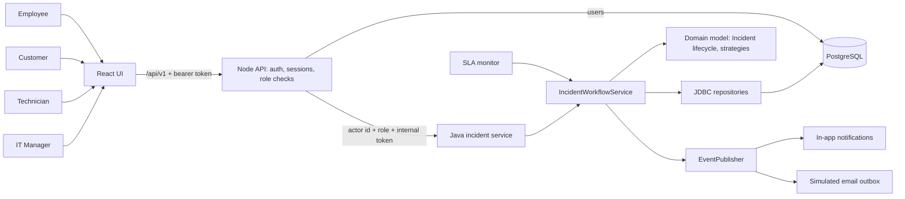
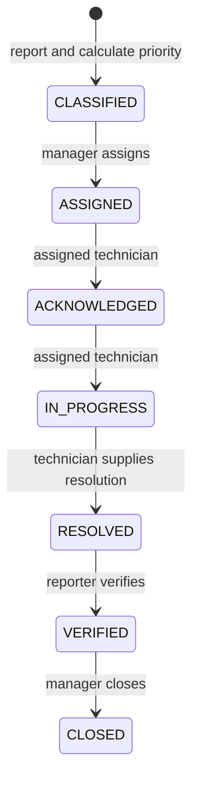

# Architecture

## Scope and assumptions

Bharat Rail ITSM is an IT service management system for a railway operator's IT services (booking, payment, database, enquiry and network systems). It is not a train-booking application or a general railway complaint portal: it handles IT incidents such as a payment gateway timing out or the PNR service failing because of a database outage.

Users are employees, customers (members of the public who report an IT problem they ran into), technicians and the IT manager (the course's Administrator role). Bharat Rail, its services and the SLA targets are fictional course values, not official policy of any real operator.

## Component view

The Node API owns sign-in, sessions, passwords and accounts, and checks the caller's role on every route. The Java service owns every incident rule. It rebuilds the domain `Incident` from the database, lets the domain validate the action, and stores the result. Each command runs in one database transaction (`DatabaseConnection.inTransaction`). The incident, its history entries and its notifications are committed together or not at all. See [API.md](API.md) for the endpoints.

## Screens

| Route | Audience | Purpose |
| --- | --- | --- |
| `/` | All | Role overview and recent incidents |
| `/incidents` | All | Own reports, assigned work, or the manager's queue |
| `/incidents/new` | Employee, Customer | Staff enter impact and urgency; customers only describe what happened |
| `/incidents/:id` | Scoped by role | Details, deadlines, conversation, history and the actions the user may take |
| `/management` | IT Manager | Workload, SLA and resolution reports |
| `/admin` | IT Manager | Accounts, technician teams, services, SLA policies, categories, assignment strategy, audit log |
| `/impact-simulator` | IT Manager | What-if view of which services depend on a failing one |
| `/account` | All | Change password |

## Priority

The system sets every priority; nobody types one in. `RailwayPriorityStrategy` multiplies impact × urgency × service criticality, each 1–3:

| Score | Priority |
| --- | --- |
| ≥ 20 | P1 |
| ≥ 10 | P2 |
| ≥ 5 | P3 |
| below 5 | P4 |

Two rules override the score with P1:

- **Security:** the incident's category is handled by the security team.
- **Tatkal window:** the incident was reported during the Tatkal window (the first 30 minutes after 10:00 and 11:00 IST), has high impact and high urgency, and is on a service that Tatkal bookings depend on. The IT manager marks those services (booking engine, payment gateway and core database in the demo data). A fault in catering or enquiry at 10:05 is judged on its score alone.

- **Staff** (employees) rate impact and urgency.
- **Customers** answer plain questions instead: how it affected them, whether money was taken, and whether it is still happening. `CustomerReportAssessment` turns these into impact and urgency. The category comes from the service.

The incident page explains each priority. The IT manager can override a priority with a reason, and changing an incident's category recalculates it.

## SLA

Response and resolution targets per priority are set by the IT manager. The defaults are P1 5/30, P2 15/120, P3 60/480 and P4 240/1440 minutes.

- Deadlines start when the incident is reported. Changing the priority recalculates them from that time.
- Every 30 seconds, the SLA monitor:
  - warns 5 minutes before a resolution deadline;
  - records a violation once;
  - escalates P1/P2 incidents that were not acknowledged in time.
- A late response or resolution stays a recorded violation.

## Lifecycle

These steps can happen while the incident is open:

- the technician can ask the reporter for information and wait for the answer;
- the reporter and the IT team can exchange messages;
- staff can add internal notes;
- the reporter can correct the title and description until a technician acknowledges the incident;
- the IT manager can edit any open incident, including its category.

Technicians can share work while the incident is open (`Incident.requestHandover`, `acceptHandover`, `handOff`, `handBack`):

- **Hand over:** the assigned technician asks a named colleague to take the incident ("I can't do this one"). Nothing moves until the colleague accepts; they can decline, and the requester can withdraw. Only one request can be open at a time.
- **Hand off:** for incidents that need two teams. After acknowledging, the technician records what they finished and passes the rest to another team; the available member with the fewest active incidents gets it.
- **Hand back:** the incident returns to the IT manager to be reassigned.

In every case the workload moves with the incident, the new technician acknowledges it, the SLA deadlines and the first acknowledgement time are kept, and earlier technicians are recorded as contributors. Customers see only "Another specialist from our IT team is now handling your request".

## Assignment

The IT manager can assign an incident in three ways:

- **Skill-based:** the first available technician in the team that handles the incident's category.
- **Load-based:** the matching technician with the fewest active incidents.
- **A named technician.**

The default strategy is set in the admin settings. Each category is handled by one team, so a category the IT manager adds is routed with no code change.

## OOP design

| Concept | Where |
| --- | --- |
| Encapsulation | `Incident` keeps its state private; every change goes through a method that checks the actor and the current status (`assign`, `acknowledge`, `resolve`, `edit`, `changePriority` …) |
| Inheritance | `User` → `Reporter` (`Employee`, `Customer`), `Technician`, `Administrator` |
| Polymorphism | `PriorityStrategy`, `AssignmentStrategy` and `NotificationSender` implementations are used through their interfaces |
| Strategy | `RailwayPriorityStrategy`; `SkillBasedAssignmentStrategy` and `LoadBasedAssignmentStrategy` |
| Observer | `EventPublisher` notifies the in-app and simulated email senders; `NotificationPolicy` decides who receives each event |
| Template Method | `StoredNotificationSender` defines delivery; subclasses choose the channel |
| Repository | Repository interfaces with PostgreSQL implementations (and an in-memory one for the domain demo) |
| Adapter | `Snapshot` maps database rows to domain objects and back |
| Unit of Work | `DatabaseConnection.inTransaction` gives every repository call in a command the same connection and transaction |
| Value object | `IncidentCategory`: eight standard categories plus ones the IT manager adds, compared by code |
| Custom exceptions | `DomainException` subclasses map to HTTP 403 / 409 / 422 |

## Database

The base tables are created by `schema.sql` and `seed.sql`. `integration.sql` adds:

- incident extras: acknowledgement time, affected users, the open information request;
- notifications;
- categories, with the team that handles each one;
- settings;
- the Tatkal booking-path flag on services;
- account status and the forced password change.

`npm run db:setup` applies all three and is safe to re-run.

## Before real use

This is a course project:

- Email is simulated.
- Passwords are hashed with scrypt, and sessions are random tokens stored as hashes.

A production system would also need:

- TLS;
- a managed secret store;
- pagination on the larger lists;
- rate limits beyond login;
- monitoring.
